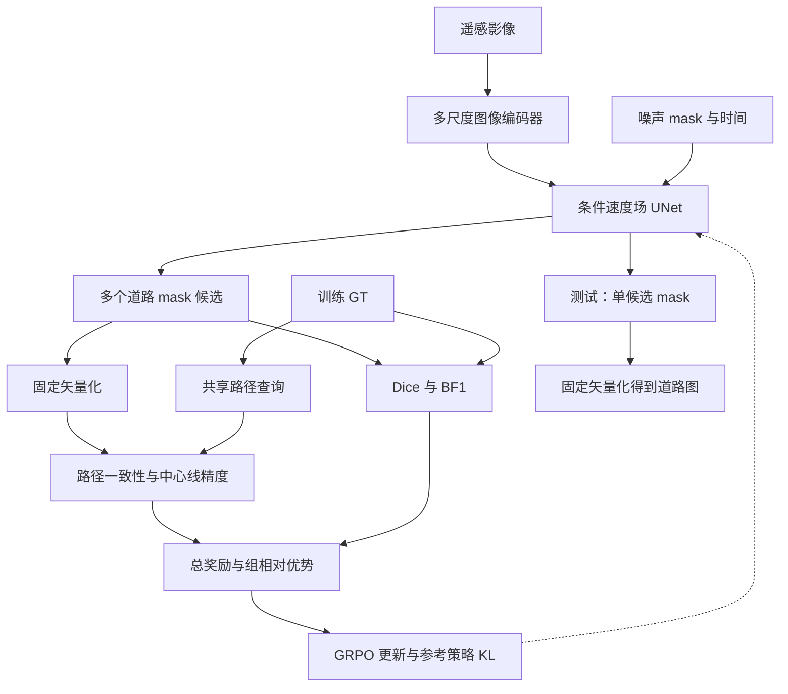

最终方案固定为：**以条件 flow matching 生成遥感道路 mask，以固定路径验证器提供奖励，通过 Flow-GRPO 后训练，提高单候选预测的道路拓扑可靠性，同时将区域与边界质量变化控制在预设范围内。**

主方法保留四项奖励：**正路径一致性、中心线 precision、Dice、BF1**。不加入负连接查询、图 Transformer、自适应奖励乘子或额外节点预测分支。下面的设计可作为实现和实验的统一依据；具体超参数是开发起点，不是已验证的最优值。

---

**研究问题围绕“候选中存在的正确拓扑，能否通过后训练变成更稳定的输出”。**

给定遥感影像 \(I\)，模型预测道路 mask \(\hat M\)，固定矢量化算子输出道路图：

\[
\hat G=\mathcal V(\hat M).
\]

训练数据包含影像、道路 mask \(M^*\) 和原生道路图 \(G^*\)。对于只有中心线图的数据，按照固定缓冲规则生成 mask。

研究假设与证据对应如下：

| 假设 | 实验证据 |
|---|---|
| 几何质量接近的生成候选具有不同拓扑质量 | 合格候选内部的平均表现与 oracle best-of-N 差距 |
| 路径奖励提供了局部几何监督遗漏的信息 | 同底座对比继续监督训练、soft-clDice 微调和筛选蒸馏 |
| 后训练提高正确拓扑的生成概率 | 单候选、相同推理预算下的 APLS／TOPO-F1 改善 |
| 改善可以迁移到未见区域 | 第二数据集验证及独立地理留出实验 |

创新定位是**面向遥感道路的路径验证后训练方法及其实证机制**。Flow-GRPO 和道路图强化学习已有相关基础，不能将“FM＋GRPO”或“道路拓扑＋RL”本身作为首次提出的贡献。[arxiv.org](https://arxiv.org/html/2505.05470v5?utm_source=chatgpt.com)

**整体模型由一个生成器、一个训练期验证器和一个策略更新过程组成。**

GT 节点和路径只进入训练期验证器。测试时只需要影像、采样器和固定矢量化流程。

---

**生成器采用独立图像编码器和像素空间条件 UNet。**

| 模块 | 最终设计 |
|---|---|
| 图像编码器 | ImageNet 预训练 ResNet-34 |
| 图像条件特征 | \(1/4、1/8、1/16、1/32\) 四个尺度 |
| mask 分支输入 | 单通道连续状态 \(x_t\) |
| mask 分支尺度 | \(1、1/2、1/4、1/8、1/16、1/32\) |
| 通道起点 | \([32,32,64,128,256,256]\) |
| 基础模块 | 残差卷积块、GroupNorm、SiLU |
| 时间条件 | 正弦编码＋MLP，注入各尺度残差块 |
| 条件融合 | 图像特征经 \(1\times1\) 投影，与同尺度 mask 特征拼接后卷积 |
| 解码器 | 上采样＋UNet 跳跃连接 |
| 输出头 | 单通道线性卷积，预测速度场，不加 sigmoid |

图像编码器只需对同一影像计算一次，所得特征可被所有候选和生成时间步复用。

主模型直接在 mask 像素空间工作，不使用 VAE 压缩。这样可以避免将细道路的保真问题与潜空间重建误差混在一起。参数量、FLOPs、显存和吞吐统一实测。

预训练阶段联合更新全部网络；后训练阶段冻结图像编码器，只更新速度场 UNet。

**监督预训练采用固定时间约定和统一的几何辅助监督。**

令：

\[
y=2M^*-1,\qquad z\sim\mathcal N(0,I),
\]

约定 \(t=0\) 为数据、\(t=1\) 为噪声：

\[
x_t=(1-t)y+tz,\qquad v^*=z-y.
\]

Flow matching 损失为：

\[
\mathcal L_{\mathrm{FM}}
=
\mathbb E\left[
\left\|
v_\theta(x_t,t,E_\phi(I))-(z-y)
\right\|_2^2
\right].
\]

从当前状态得到终点估计：

\[
\hat y_t=x_t-t\,v_\theta(x_t,t,E_\phi(I)),
\]

并映射为连续 mask：

\[
\tilde M_t=
\operatorname{clip}\left(\frac{\hat y_t+1}{2},0,1\right).
\]

预训练目标固定为：

\[
\mathcal L_{\mathrm{pre}}
=
\mathcal L_{\mathrm{FM}}
+\lambda_{\mathrm{seg}}
\mathcal L_{\mathrm{softDice}}(\tilde M_t,M^*).
\]

\(\lambda_{\mathrm{seg}}\) 仅在底座开发阶段选择；底座确定后，全部同底座方法使用同一 checkpoint、同一输出映射及同一标签处理。

增强使用翻转、直角旋转和适度颜色扰动。256 调试阶段使用原尺度裁块，不直接将 512 缩小到 256，以免改变道路宽度与连接关系。

---

**验证器固定图提取规则，不主动修复道路。**

矢量化流程为：

1. 连续输出按固定阈值二值化。
2. 固定骨架化。
3. 构建带空间长度的骨架图。
4. 聚合交叉点区域。
5. 压缩度为 2 的节点，保留折线及其长度。
6. 保留环路，明确处理孤立点和短末端分支。

不使用闭运算补路、跨间隙连边或 A* 修复。必要的去噪参数在开发集上确定，对所有 mask 方法保持一致。

匹配距离、节点合并距离、采样间隔和边界容差尽量使用物理距离；使用像素单位时，随地面分辨率统一换算。

**路径奖励通过多尺度控制点对评价断连、绕行和异常捷径。**

GT 控制点池包含：

- 道路端点；
- 交叉点；
- 沿道路等间距采样的中间点。

中间点用于覆盖环路和较长路段，减少对原始图节点拆分方式的依赖。

每条查询为：

\[
q=(u,v,d_q^*),
\]

其中 \(u,v\) 在 GT 图中可达，\(d_q^*\) 为最短路径长度。按训练查询池的长度分布划分短、中、长三档，每张影像初始采样 48 条，各档数量相同。

同一候选组必须共享查询。查询数量最终由重测稳定性和计算成本确定。

将 GT 控制点投影到预测折线，设置最大匹配距离，必要时插入投影节点。匹配失败按零分计入分母：

\[
r_q=
\begin{cases}
0,&\text{匹配失败或预测不可达},\\[4pt]
1-\min\left(
1,\frac{|\hat d_q-d_q^*|}{d_q^*+\epsilon}
\right),&\text{其他情况}.
\end{cases}
\]

\[
R_{\mathrm{path}}
=
\frac1{|Q|}\sum_{q\in Q}r_q.
\]

这是**采样 APLS 风格奖励**，不等同于官方 APLS。测试使用独立的标准实现，并固定控制点插入、匹配和路径评价配置。[github.com](https://github.com/CosmiQ/apls?utm_source=chatgpt.com)

裁块中只使用 GT 路径完整位于可见上下文内的查询。仅检查端点在块内是不够的。

**中心线 precision 抑制额外道路，Dice 和 BF1 保护几何质量。**

在预测中心线上等间距采样得到 \(\hat S\)，GT 中心线为 \(S^*\)：

\[
P_c=
\frac1{|\hat S|}
\sum_{p\in\hat S}
\mathbf1[d(p,S^*)\le\rho].
\]

非空 GT 下的空预测取 \(P_c=0\)。等间距采样避免折线顶点密度改变分数。

主奖励固定为：

\[
\boxed{
R=
w_pR_{\mathrm{path}}
+w_cP_c
+w_d\mathrm{Dice}
+w_b\mathrm{BF1}
}
\]

四项权重非负且和为 1。开发起点采用：

\[
(w_p,w_c,w_d,w_b)=(0.5,0.2,0.2,0.1).
\]

只对路径权重做小范围扫描，其余三项保持比例，避免大规模搜索。

BF1 保留在主奖励中。Dice hinge、移除 BF1、逐分量标准化均不进入主方法。

对于空 GT 裁块，不计算路径和中心线项，使用：

\[
R_{\mathrm{empty}}
=
1-\frac{|\hat M|}{HW}.
\]

正确空预测获得最高分；有错误前景时按面积扣分。不能只用骨架长度惩罚空场景中的假阳性，因为宽前景块可能具有很短的骨架。

**路径错误按方向拆分报告，但不额外增加奖励项。**

对有效匹配且可达的查询：

\[
e_q=\frac{\hat d_q-d_q^*}{d_q^*}.
\]

| 类型 | 判定 |
|---|---|
| 匹配失败 | 至少一个控制点未有效匹配 |
| 断连 | 控制点有效，但预测不可达 |
| 异常绕行 | \(e_q>\tau\) |
| 异常缩短 | \(e_q<-\tau\) |
| 长度一致 | \(|e_q|\le\tau\) |

\(\tau\) 根据回环误差和开发集确定，测试前固定。

异常缩短只是错误捷径的代理指标，不称为错连率。短接若没有改变采样路径，可能漏检；该局限通过反例及真实案例报告。

---

**后训练沿用 Flow-GRPO 的随机采样机制，并明确概率比的实现形式。**

使用包含漂移修正的 ODE→SDE 转换，每步具有高斯转移：

\[
x_{t-h}\sim
\mathcal N\left(
\mu_\theta(x_t,t,I),
\sigma_t^2h\,\mathbf I
\right).
\]

时间方向、端点处理和噪声调度均与固定版本的参考实现保持一致。不能只在 ODE 更新后随意添加噪声。[arxiv.org](https://arxiv.org/html/2505.05470v5?utm_source=chatgpt.com)

主配置先采用完整 SDE 采样，最终连续输出直接阈值化。终态截断不能被当作去毛刺方法，也不能修改保存的随机状态后仍按原高斯转移计算 log-prob。

对每张影像生成 \(G\) 个候选，总奖励组内标准化：

\[
A_i=
\frac{R_i-\bar R}{\operatorname{std}(R)+\epsilon}.
\]

主实现沿用参考代码的空间平均 log-prob：

\[
\ell_\theta=
\frac1P\sum_{j=1}^{P}\log p_\theta(x'_{j}\mid x),
\qquad
\tilde r_{i,t}
=
\exp(\ell_\theta-\ell_{\mathrm{old}}).
\]

这里的 \(\tilde r\) 是**按维度缩放的 surrogate ratio**，不是原始联合概率比。Flow-GRPO 官方相关实现确实采用非 batch 维度平均，论文和代码应如实说明这一选择。[github.com](https://github.com/yifan123/flow_grpo/blob/main/flow_grpo/diffusers_patch/sd3_sde_with_logprob.py?utm_source=chatgpt.com)

优化目标为：

\[
\mathcal L_{\mathrm{post}}
=
-\mathbb E_{i,t}
\left[
\min\left(
\tilde r_{i,t}A_i,
\operatorname{clip}(\tilde r_{i,t},1-\varepsilon_c,1+\varepsilon_c)A_i
\right)
\right]
+\beta\overline{\mathrm{KL}}.
\]

其中 KL 也使用明确一致的维度归约。

- \(\pi_{\mathrm{old}}\)：生成当前轨迹的策略，用于概率比。
- \(\pi_{\mathrm{ref}}\)：冻结底座，用于 KL。
- 奖励计算不反向传播，梯度通过策略目标更新速度场网络。
- 主配置不加入监督回放，避免增加方法组件；若必须使用才能稳定，应在开发结束前确定，并同步修改方法说明和消融。

**几何保持由绝对指标监控和 checkpoint 门槛完成。**

预先规定允许下降量：

\[
D_\theta\ge D_0-\delta_D,\qquad
B_\theta\ge B_0-\delta_B.
\]

在满足两项门槛的验证 checkpoint 中选择拓扑指标最高者。门槛在测试前固定，不能根据测试结果放宽。

固定奖励、KL 和门槛共同构成几何保护，但不声称保证硬约束成立。若没有 checkpoint 达标，该配置即未达到目标。

训练记录必须包含：

- 各奖励分量的均值、组内标准差及加权标准差；
- 分量间相关性；
- 几何门槛通过率；
- KL、概率比和 clip fraction；
- 低方差组比例，并区分全高、全低及其他情况。

---

**单卡配置以可检查的同步流程为起点。**

| 项目 | 起始配置 |
|---|---|
| 调试／正式分辨率 | 256 裁块／512 裁块 |
| 同图候选数 | \(G=8\)，显存不足时先以 4 调试 |
| 采样步数 | 16 为起点，开发期比较 8／16／32 |
| 查询数 | 每图 48，开发期比较 24／48／96 |
| 策略学习率 | \(10^{-5}\) 附近有限搜索 |
| micro-batch | 1，配合梯度累积 |
| 计算精度 | 网络混合精度，转移参数、log-prob、KL 和优势用 FP32 |
| 更新时间步 | 每条轨迹均匀抽取部分有效随机转移步 |
| 图像编码器 | 冻结，复用条件特征 |
| 奖励计算 | GT 缓存、指定源点最短路、CPU 并行 |
| 训练调度 | 先同步，稳定后才优化流水线 |

必须通过的实现检查：

1. 更新前同轨迹重算概率比接近 1。
2. 采样与重算的状态、时间表、方差完全一致。
3. 确定性转移不作为普通高斯转移计算策略损失。
4. 修改分辨率后重新检查 KL 和 clipping。
5. 分别测量 rollout、奖励、参考前向、策略更新及数据传输耗时。

不预设 CPU 是瓶颈，也不预设单通道 mask 意味着显存一定足够。

---

**验证器可靠性测试必须先于大规模后训练。**

| 测试 | 要检查的性质 |
|---|---|
| 非空 mask 与自身比较 | 有效查询分数在浮点容差内为 1 |
| GT 图→栅格化→提图→原图比较 | 量化表示误差，不调容差逼近 1 |
| 删除关键道路片段 | 路径分数明显下降 |
| 增加远离 GT 的支路 | 中心线 precision 下降 |
| 整体加宽 | Dice／BF1 下降 |
| 平行道路短接 | 观察异常缩短及漏检 |
| 节点重划分 | 路径和几何分数基本稳定 |
| 环路、空图、孤立点 | 处理明确，无虚假满分或异常 |
| 重复抽取查询 | 候选奖励差值和排序稳定 |
| 与官方 APLS 比较 | 能否选出官方指标更好的候选 |

查询可靠性通过 24／48／96 条查询的排序稳定性、耗时和选优效果决定，不使用未经验证的“相关系数必须大于 0.5”等硬门槛。

采样扫描同时记录短末端分支密度、小连通域面积比例和 GT 对照。真实短支路不能全部被定义为毛刺。

**oracle 诊断只测量几何合格候选中的拓扑空间。**

在分层抽取的验证影像上，每图生成 16 个候选。使用冻结底座、固定的独立参考种子得到单图参考 Dice／BF1，定义：

\[
\mathcal E(I)=
\{i:
D_i\ge D_{\mathrm{ref}}(I)-\delta_D,\;
B_i\ge B_{\mathrm{ref}}(I)-\delta_B
\}.
\]

为减少单次参考波动，可固定少量参考采样并取均值；该规则在诊断前确定。

报告：

- 合格候选比例；
- 合格候选平均官方 APLS；
- 合格候选 oracle 最优 APLS；
- 二者差距；
- 合格候选不足两个的影像比例。

该结果用于判断后训练空间，不作为部署性能，也不保证 GRPO 必然达到 oracle 水平。

---

**数据固定为 SpaceNet＋City-scale，地理留出单独构成一个小实验。**

| 协议 | 设置 |
|---|---|
| 主协议 | 明确版本的 SpaceNet，采用公开可复现划分 |
| 第二数据集 | City-scale，采用其公开划分并重新训练 |
| 地理留出 | 从主数据集选定一个完整城市或独立区域，重新构建不含该区域的训练集 |

主协议不因地理留出而悄悄改变公开划分。留出实验只做一次固定区域，不做多城市轮流交叉验证，并只训练底座、最强基线和完整方法。

SpaceNet 与 City-scale 已被道路图方法使用，便于对接公开协议，但具体版本、下载来源、训练清单及评价配置必须在实现时锁定。[github.com](https://github.com/TonyXuQAQ/RNGDetPlusPlus?utm_source=chatgpt.com)

数据处理统一要求：

- 按地理单元划分后再裁块，避免重叠泄漏。
- 原生图与栅格 mask 的来源分别记录。
- 空裁块比例固定并报告。
- 中心线缓冲宽度固定，不能按方法单独调整。
- 地理留出区域不用于调参和 checkpoint 选择。
- BF1 只表述为对栅格标签边界的保持。
- 立交等非平面连接作为二值 mask 的表示限制披露，完整测试集结果不隐藏。

---

**同底座对照固定为五组，是论文的核心实验。**

| 编号 | 方法 | 作用 |
|---|---|---|
| B0 | FM 监督底座 | 初始水平 |
| B1 | 继续监督训练 | 排除额外训练带来的收益 |
| B2 | soft-clDice 微调，保留区域监督 | 比较可微拓扑监督 |
| B3 | 离线筛选蒸馏 | 比较奖励驱动的候选筛选学习 |
| Ours | 四项奖励的 GRPO＋KL | 完整方法 |

B2 的 soft-clDice 施加于与预训练一致的连续终点估计，保留原有几何监督，避免构造容易退化的弱基线。clDice 官方实现同样建议结合区域损失。[github.com](https://github.com/jocpae/clDice/blob/master/Readme.md?utm_source=chatgpt.com)

B3 固定为：冻结底座生成每组 \(G\) 个候选，按与 GRPO 相同的奖励选择 top-1，随后监督微调。不再扫描多个 \(k\)。

公平性报告包括：

- 候选生成总数；
- 采样步数和生成网络调用总数；
- 奖励评价次数；
- 参数更新次数；
- GPU 小时。

离线蒸馏与在线 GRPO 的对比只支持“优于该离线方案”，不能把全部差异归因于策略梯度。迭代蒸馏不列为必做实验；只有论文需要进一步主张在线策略梯度的独立价值时才增加。

**外部方法控制在三个类型，图指标与 mask 指标分开比较。**

| 类型 | 对照 |
|---|---|
| 判别式分割 | 同编码器 UNet／FPN，配相同矢量化 |
| 道路图提取 | SAM-Road 系列或 RNGDet++ 中可复现的方法 |
| 生成式分割 | 兼容协议的公开扩散方法；若无法复现，则使用同骨干条件 DDPM，并明确为受控基线 |

不追求覆盖所有最新方法。图输出方法主要比较 APLS、TOPO 和效率，不通过任意宽度栅格化后比较 BF1。

**必做消融只保留三个，其他因素在开发期筛选。**

| 消融 | 需要观察的现象 |
|---|---|
| 去掉路径项 | 路由改善是否减弱 |
| 去掉中心线 precision | 多余支路和假阳性是否增加 |
| 去掉 Dice／BF1 | 区域或边界退化是否加重 |

消融结果不预设一定符合预期。若某项删除后没有变化，应如实报告并重新判断其必要性。

辅助扫描仅包括：

- ODE／SDE 与 8／16／32 步；
- 少量噪声强度；
- 必要时比较 \(G=4、8、16\)；
- 阈值和匹配容差的小范围敏感性。

不做完整笛卡尔组合。hinge、负查询、逐分量标准化及困难查询课程均不进入必做清单。

---

**主评价使用单候选和完整大图结果。**

每个裁块只生成一个候选，采用固定的连续输出加权滑窗融合，随后阈值化并构建完整道路图。底座与完整方法使用相同窗口、重叠、噪声协议和矢量化参数。

主结果固定一种采样器，另一种作为补充。重复采样种子时，每次独立计算单候选结果，再报告均值与波动，不做候选挑选或集成。

| 维度 | 指标 |
|---|---|
| 拓扑主指标 | 官方 APLS、TOPO-F1 |
| 错误分解 | 匹配失败、断连、绕行、异常缩短 |
| 区域与边界 | IoU、Dice、固定容差 BF1 |
| 中心线 | precision、recall、F1 |
| 推理成本 | 每图及每平方公里耗时、网络调用次数、峰值显存 |
| 训练成本 | GPU 小时、候选数量、奖励及更新耗时 |

主要成功判据为：

**相同单候选推理预算下，官方拓扑指标改善，且 Dice／BF1 变化处于预设容忍范围内。**

训练奖励使用采样查询，正式评价使用官方图指标和独立查询集合，避免只证明被优化的奖励提高。

**多种子设计只覆盖必要部分，并准确限定方差来源。**

主数据集上：

- B1、B2、B3 和完整方法先各做一次。
- 根据验证集预设规则确定最强同底座基线。
- 该基线和完整方法各做 3 次独立后训练，均从同一个底座出发。
- B0 只重复推理采样，没有“后训练种子”。

因此统计反映的是**给定底座的后训练稳定性**，不包含预训练随机性。

第二数据集和地理留出只比较 B0、最强基线与完整方法，采用单次后训练并重复少量推理种子。报告均值、标准差、分城市差值，不把描述性门槛检查写成正式非劣效证明。

---

**论文的图表和执行顺序围绕同一条证据链安排。**

| 图表 | 内容 |
|---|---|
| 动机图 | 几何相近、拓扑不同的候选，以及合格候选 oracle 差距 |
| 架构图 | 生成器、训练期验证器、GRPO 和单候选推理 |
| 协议表 | 数据版本、划分、标签生成、评价配置 |
| 主结果表 | 两数据集的几何、拓扑和成本 |
| 对照表 | 五组同底座比较及三项奖励消融 |
| 权衡图 | APLS—Dice／BF1 |
| 稳定性图 | 噪声、步数、奖励方差、合格候选比例 |
| 案例图 | 遮挡、细路、平行道路、路口、裁块接缝及失败案例 |

执行顺序固定为：

1. **验证器与反例测试**：确认奖励行为和表示误差。
2. **SpaceNet 子集底座**：确定采样质量与计算成本。
3. **合格候选诊断**：确认存在可利用的拓扑差异。
4. **256 小规模后训练**：完成实现检查及同底座初步对照。
5. **512 正式实验**：主数据集、核心重复、第二数据集和地理留出。

最终复现材料包含数据清单、栅格化与矢量化配置、查询池及采样种子、奖励测试、训练配置、评测版本、checkpoint 和成本日志。

论文的三条贡献据此落定：**量化遥感道路候选的几何—拓扑差异；提出带几何保护的路径验证后训练方法；验证其在单候选预测、第二数据集和未见区域中的拓扑收益。**